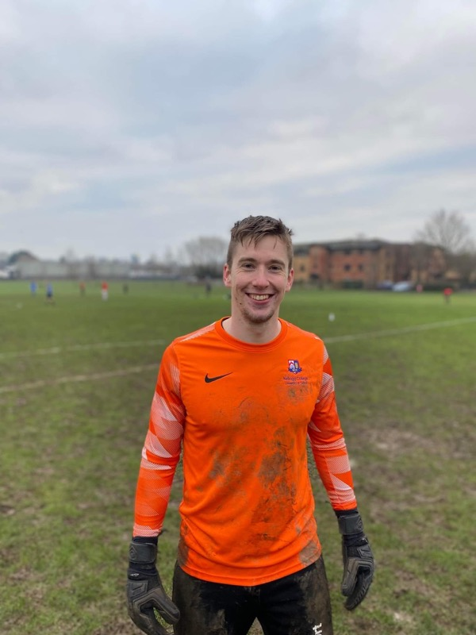
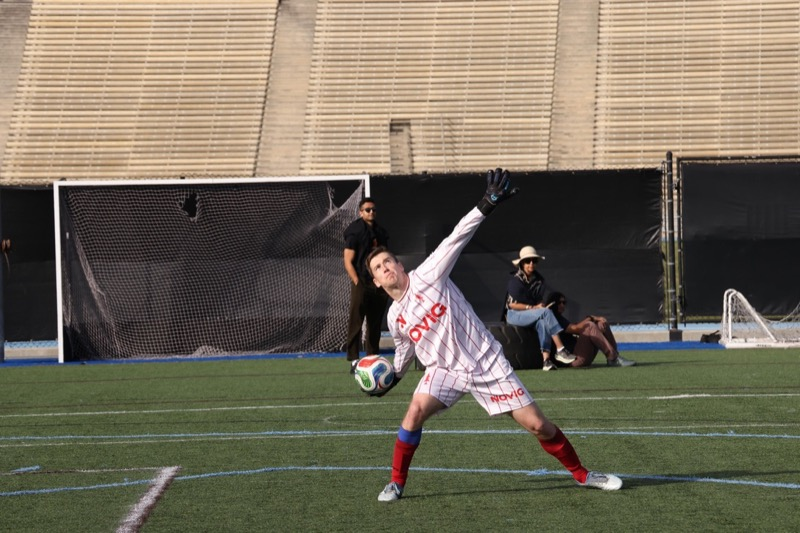
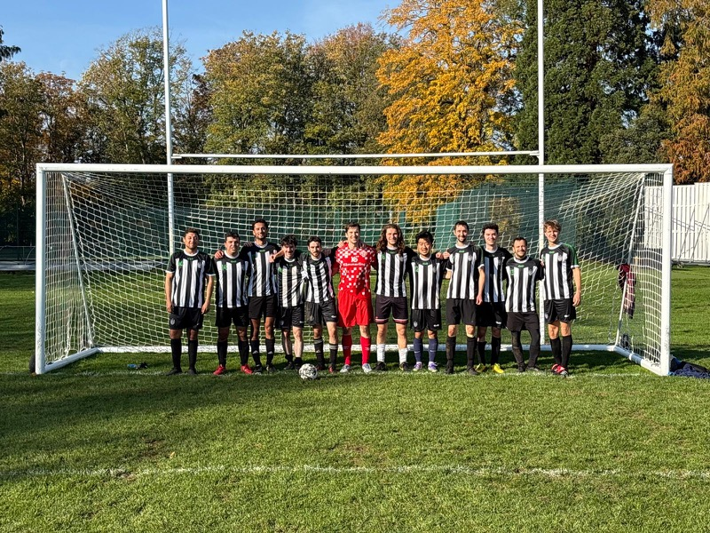
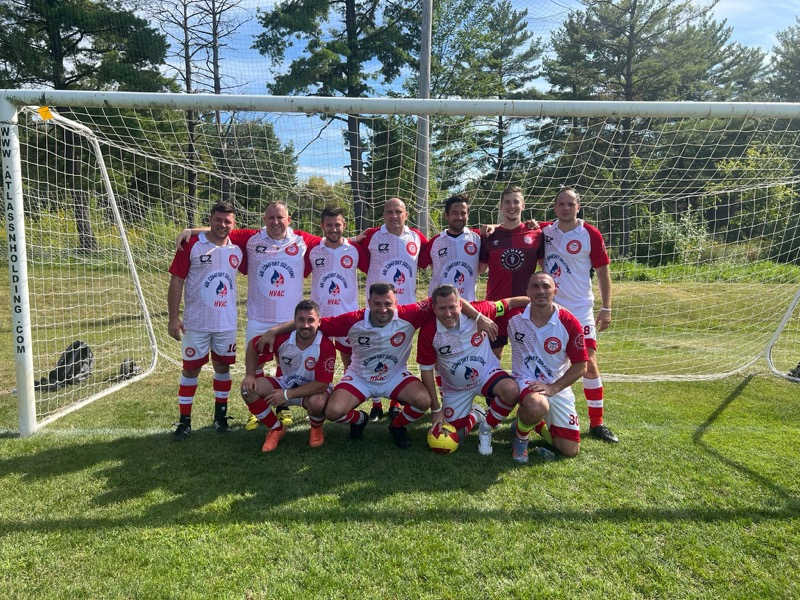
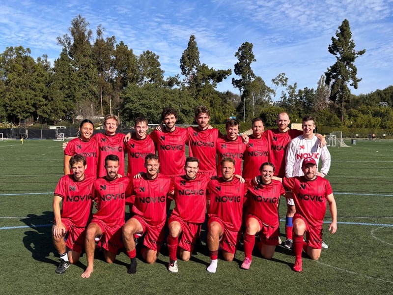
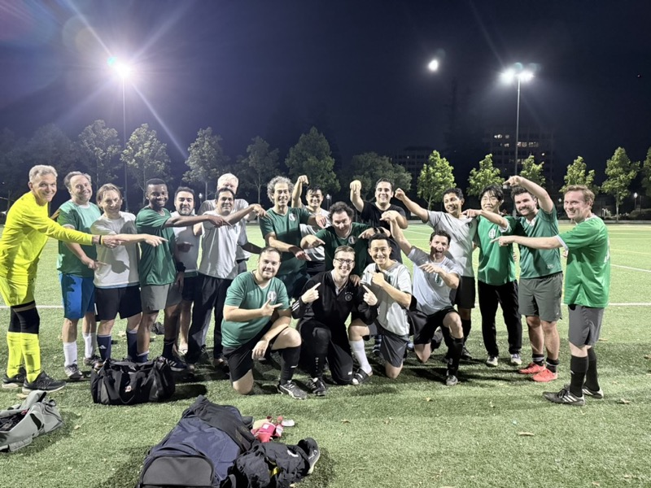

I have played football as a goalkeeper since I was nine years old. Growing up in Germany, the game was a constant -- through school, university, and every move abroad. I have played in **Germany**, **England**, **Norway**, the **United States**, and I still play regularly in the UK. Football is what first drew me to psychology: much of what I study today -- how people share and perceive emotions, how emotional dynamics shape group performance -- is rooted in questions I first encountered on the pitch.

  

---

## Research

My academic interest in sports centres on the emotional and psychological dimensions of team performance. How do emotions spread within a squad? How do players and coaches perceive emotional expressions under pressure, and how does this affect collective decision-making?

This interest extends into applied work. From 2017 to 2018, I worked with **Leicester City Football Club Academy**, where I designed psychological resilience assessments for Premier League youth player selection that were adopted into the club's official recruitment process. I also introduced evidence-based psychometric tools to coaching and senior management.

Since 2026, I serve as **Scientific Advisor** to **[Game1.ai](https://www.game1.ai)**, a sports technology startup where I help conceptualise, operationalise, and validate standardised psychological test batteries that evaluate cognitive, emotional, and behavioural metrics in academy soccer players.

I remain broadly interested in how emotion science can inform sports psychology -- from talent identification and athlete well-being to group dynamics and leadership in high-performance teams.

  

---

## Teams

Football has connected me to communities everywhere I have lived.

  

    
    
Oxford

  

  

    
    
Boston

  

  

    
    
Stanford

  

If you are new to any of these places -- or to **Southampton**, where I currently play -- and looking for a team, feel free to reach out. I am happy to help you get connected.

---

## Community Engagement

### Town & Gown Football

During my time at the University of Oxford, I helped organise **Town & Gown Football**, a community initiative that brought together university students and local residents through regular football matches and events. The project was recognised with the **Oxford University Public Engagement Award** in 2022 for its contribution to building bridges between the university and the wider Oxford community.

  

I believe that sport is one of the most powerful tools for community engagement, and I am always looking for opportunities to use football to bring people together -- whether in an academic setting or beyond. If you have an idea for a similar initiative in Southampton or elsewhere, I would love to hear about it.
